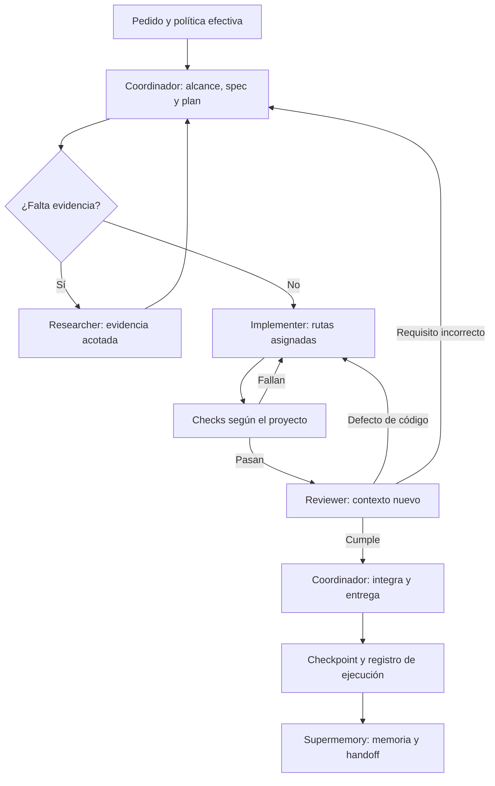

# harness-nicovon24

> **Especificación histórica:** [docs/PLAN.md](docs/PLAN.md) conserva las decisiones vigentes. Para este hito, la memoria del proyecto basta para reanudar y Supermemory es un piloto explícito; la memoria global remota queda pospuesta. Las secciones inferiores que describen Supermemory como predeterminado o exigen exportar cada checkpoint fueron reemplazadas. Retomar con `node bin/harness.mjs memory-render --project .`, sin abrir `MEMORY.md` directamente. El prompt maestro final es referencia, no una orden automática.

Arnés personal de desarrollo guiado por especificaciones, planificación y orquestación de agentes, adaptable a cada proyecto y portable entre clientes.

**Autor:** Nicolás Von Muhlinen
**Documento:** especificación inicial y guía de implementación
**Fecha:** 17 de octubre de 2026
**Estado:** diseño actualizado; las capacidades deben implementarse y verificarse antes de declararse disponibles.
**Últimas decisiones:** modelos dinámicos con defaults, Supermemory como memoria persistente y exclusión de escritores entre sesiones.

> Este README es el punto de partida del repositorio. Al implementar cada etapa, actualizar su estado, sus comandos reales y su evidencia. La sección final contiene el prompt maestro para el Codex local.

## 1. Resultado que debe ofrecer

Abrir cualquier proyecto y poder pedir especificar, implementar, depurar o revisar mediante comandos conocidos. El arnés lee las reglas particulares del repo, prioriza la planificación cuando el cambio lo necesita, delega trabajo real, ejecuta las comprobaciones correspondientes y conserva un punto de reanudación.

El arnés debe permitir:

- Elegir un coordinador predeterminado y cambiarlo posteriormente.
- Trabajar en modo individual, automático o con equipo.
- Configurar modelos y esfuerzo por responsabilidad, con defaults estables y overrides por proyecto o ejecución.
- Activar TDD por proyecto o tarea; por defecto se usa testing estándar.
- Aplicar SDD con profundidad proporcional al alcance y al riesgo.
- Compartir un núcleo entre Commerce Lab, Blackfruit y otros proyectos.
- Conservar reglas, especificaciones y estado al cambiar a Claude o Pi.
- Preparar ejecución no interactiva en CI mediante un adaptador.
- Continuar con un procedimiento básico si Superpowers falla; ante un fallo de Supermemory, conservar la ejecución y la sincronización pendiente.
- Mantener la configuración técnica de cada producto en su propio repositorio.

La portabilidad se demuestra con pruebas por entorno. Un catálogo visible o una instrucción Markdown no demuestra que exista delegación, conexión o persistencia.

## 2. Decisiones acordadas

| Tema | Decisión |
|---|---|
| Nombre | `harness-nicovon24` |
| Base inicial de workflows | Superpowers, como dependencia reemplazable |
| Coordinación y planificación | Astra `medium` como default inicial, configurable |
| Investigación delimitada | Luna `high`; `medium` para inventarios o extracción sencilla |
| Implementación | Sol `medium` |
| Revisión | Sol `high` con contexto nuevo, configurable |
| Concurrencia | Máximo dos subagentes activos, además del coordinador |
| Modo predeterminado | `auto`, con delegación conservadora |
| Testing predeterminado | `standard`; TDD solo por elección explícita |
| Memoria persistente entre sesiones | Supermemory |
| Código y acuerdos verificables | Git: código, specs y evidencia |
| Registro operativo local | Recuperación y cola de sincronización, fuera de Git |
| Sesiones concurrentes | Un escritor por checkout y por feature; aislamiento para trabajos paralelos |
| Primer entorno | Windows, PowerShell 5.1, Orca y Codex |
| Portabilidad posterior | Claude, Pi y CI |
| Lenguaje de la documentación | Español; código y contratos con nombres consistentes |

ECC ya fue retirado según confirmación del usuario. No reinstalarlo para implementar este arnés.

La auditoría previa se ejecutó con Sol `medium`. El default confirmado para nuevas ejecuciones es Astra `medium`; Sol `high` queda disponible como perfil alternativo. Los identificadores exactos se resuelven y fijan por adaptador. Configurar un default no cambia el modelo de una sesión ya iniciada.

La auditoría anterior identificó un `CODEX_HOME` administrado por Orca, distinto de la ruta predeterminada habitual. Inspeccionar la ubicación efectiva; nunca asumirla ni sustituirla globalmente.

## 3. Límites del arnés y del proyecto

| Vive en harness-nicovon24 | Vive en cada proyecto |
|---|---|
| Workflows, roles y formatos de encargo | Stack y versiones de la aplicación |
| Comandos de trabajo y adaptadores | `package.json`, scripts y lockfiles |
| Plantillas de specs, tareas y revisión | Reglas del negocio y contratos |
| Política general de verificación | ESLint, formateo, Husky y lint-staged |
| Procedimiento de checkpoint | Tests, fixtures y datos de prueba |
| Integración y diagnóstico de memoria | CI/CD, Docker, Terraform y despliegues |
| Instalación y validación del arnés | Comandos y servicios necesarios para desarrollar |
| Valores personales predeterminados | Specs, decisiones y estado de sus features |

El arnés consulta los archivos técnicos existentes y ejecuta los comandos del proyecto cuando corresponde. No replica su configuración ni impone pnpm, Next.js o AWS a todos los repos.

El propio arnés sí necesita comprobaciones y CI para su código: validar configuración, instaladores y adaptadores. Esto es distinto del pipeline de cada producto.

Las credenciales y los datos de autenticación permanecen fuera de Git. El arnés guarda referencias a variables o conexiones, nunca sus valores.

## 4. Arquitectura

| Capa | Responsabilidad |
|---|---|
| Núcleo | Reglas, workflows, roles, plantillas y criterios de cierre |
| Política efectiva | Resolver preferencias globales, configuración del repo y pedido actual |
| Proveedor de workflows | Superpowers o el procedimiento básico de respaldo |
| Adaptador | Traducir instrucciones, roles y herramientas al cliente |
| Runtime | Crear agentes y ejecutar herramientas reales |
| Proyecto | Aportar código, comandos, restricciones y aceptación |
| Estado y memoria | Conservar progreso verificable y contexto recuperable |

Una sola capa decide la orquestación de una tarea. Las skills especializadas de diseño, seguridad o Caveman pueden asistir, pero no iniciar otro coordinador independiente sobre el mismo trabajo.

### Flujo con equipo



El código revisado debe identificarse mediante commit de referencia y un snapshot que incluya cambios locales y archivos nuevos pertinentes. Vincular también la revisión a la versión de la spec. Una edición posterior relevante reabre las comprobaciones y la revisión afectadas. Si falla Supermemory, el registro local conserva lo pendiente y muestra que la sincronización no terminó.

## 5. Comandos de trabajo

Son workflows que se implementarán como skills o entradas equivalentes del cliente.

| Nombre propio | Alcance y salida |
|---|---|
| `h-start` | Resolver proyecto y modelos, recuperar Supermemory, contrastar estado local y retomar el próximo paso |
| `h-doctor` | Mostrar el diagnóstico del entorno mediante comprobaciones reproducibles |
| `h-spec` | Escribir alcance, requisitos, diseño y tareas; terminar antes de implementar |
| `h-feature` | Completar una feature, creando o reutilizando una spec, con checks, revisión y checkpoint |
| `h-debug` | Reproducir, aislar, corregir y verificar un fallo |
| `h-review` | Revisar código y aceptación; no editar el código inspeccionado |
| `h-checkpoint` | Guardar el registro operativo y persistir en Supermemory evidencia resumida, pendientes y próximo paso |

`h-feature` reutiliza la fase de especificación de `h-spec`. No mantener dos implementaciones diferentes de esa lógica.

Cada comando resuelve la política y los perfiles antes de actuar, aunque no se haya ejecutado `h-start`. Todo recorrido que edite debe comprobar además la propiedad de la ejecución y los bloqueos correspondientes. El adaptador documenta si puede iniciar automáticamente el arnés o si requiere invocación explícita. La presencia de archivos en disco no garantiza su activación.

### Ejemplos de interfaz prevista

Una vez instaladas las skills, el adaptador Codex debe verificar y documentar la invocación admitida por su versión:

```text
$h-start
$h-feature Agregar seguimiento de muestras. Modo: auto. Testing: standard.
$h-feature Implementar el adaptador sandbox. Modo: team. Testing: tdd.
$h-feature Agregar descuentos. Coordinador: Sol high. Modo: team.
$h-debug Las reservas no se liberan al cancelar. Modo: solo.
$h-spec Definir descuentos por cantidad. Terminar en la especificación.
$h-review Revisar la feature activa contra su aceptación.
$h-checkpoint Guardar el estado para la próxima sesión.
```

`Modo:`, `Testing:` y `Coordinador:` son convenciones propias que el workflow debe resolver. No son flags nativos de Codex ni de Superpowers.

El adaptador Claude puede ofrecer `/h-feature` y equivalentes. Pi necesita sus convenciones y capacidades propias. Nunca documentar una sintaxis como funcional sin probar su descubrimiento e invocación.

## 6. Comandos operativos y alcance de la CLI

La CLI del arnés administra configuración e instalación. En la primera versión no construye otro runtime de agentes ni ejecuta modelos por su cuenta.

Contrato de terminal propuesto, a implementar y probar:

```text
node bin/harness.mjs init --project <ruta>
node bin/harness.mjs validate --project <ruta>
node bin/harness.mjs doctor --project <ruta>
node bin/harness.mjs config --project <ruta>
node bin/harness.mjs install --runtime codex --project <ruta> --dry-run
node bin/harness.mjs install --runtime codex --project <ruta> --apply
node bin/harness.mjs uninstall --runtime codex --project <ruta> --dry-run
node bin/harness.mjs uninstall --runtime codex --project <ruta> --apply
```

- `init`: crea solo los archivos faltantes del proyecto y muestra conflictos.
- `validate`: valida esquema, rutas, referencias y compatibilidad declarada.
- `doctor`: diferencia configuración, disponibilidad, conectividad y uso comprobado.
- `config`: imprime la política efectiva y su procedencia, sin secretos.
- `install`: prepara o aplica archivos del adaptador con respaldos y ownership.
- `uninstall`: elimina solo lo instalado por el arnés y preserva modificaciones ajenas.

Es una interfaz especificada, no código ya disponible. Si se necesita modificarla durante la implementación, documentar la decisión y actualizar ejemplos y pruebas.

La v0.1 puede usar Node.js 22 o superior y módulos `.mjs`, como decisión de implementación para compartir lógica entre Windows y Linux. Evitar una compilación o un framework si no aporta una necesidad concreta. Justificar dependencias; no implementar un parser general de TOML o JSON Schema artesanal.

`doctor` no ejecuta instalaciones, migraciones, seeds, despliegues ni procesos del producto. Los workflows de trabajo pueden ejecutar los checks pertinentes después de inspeccionar su alcance.

## 7. Modos y modelos dinámicos con defaults

| Modo | Regla |
|---|---|
| `solo` | Ningún subagente; la revisión propia se registra como autorrevisión |
| `auto` | El coordinador delega únicamente trabajo separable o revisiones justificadas |
| `team` | Delegación explícita por responsabilidades, con revisión independiente |

Cambiar el modo no cambia por sí mismo los modelos ni elimina una revisión obligatoria. Si falta esa revisión, el cierre queda pendiente. Sin herramientas reales de delegación no se simula un equipo cambiando de personaje.

### Defaults iniciales

| Rol lógico | Perfil | Esfuerzo |
|---|---|---|
| `coordinator` | Astra | `medium` |
| `researcher` | Luna | `high` |
| `implementer` | Sol | `medium` |
| `reviewer` | Sol, contexto nuevo | `high` |

El coordinador conserva alcance, spec, plan, decisiones e integración. Un `spec_author` separado es opcional cuando aporta valor.

### Resolución dinámica

- Defaults personales en `config/defaults.json`.
- Overrides por rol en `harness/project.json`.
- Overrides explícitos para una ejecución concreta.
- Reglas automáticas únicamente cuando estén configuradas y autorizadas.
- Sin regla ni override, siempre se aplica el default.

La prioridad para preferencias es ejecución > proyecto > personal. Cada override de un rol especifica el par perfil y esfuerzo, validado como unidad. No persistir una elección de tarea como nuevo default sin un pedido explícito.

El núcleo usa roles; el adaptador mantiene el mapa entre perfiles y modelos exactos disponibles. No resolver `sol` como una versión nueva arbitraria en cada inicio. Fijar el mapa, registrar cambios y comprobar capacidades.

Sol high queda como alternativa para trabajos que el usuario o una regla autorizada le asignen. Todos los roles y sus esfuerzos son personalizables; los demás valores de la tabla son defaults iniciales. También se puede elegir Sol high como único agente en `solo`. Cambiar una responsabilidad no exige reescribir el workflow.

Antes de delegar, registrar la política efectiva, versión del arnés, perfiles, identificadores resueltos y esfuerzo. Registrar por separado el modelo solicitado y el reportado por la herramienta cuando exista; el propio agente no certifica su identidad.

El preflight comprueba delegación, elección de modelo/esfuerzo, revisión desde contexto nuevo, memoria y controles de escritura requeridos. Resolver bloqueos o fallbacks autorizados antes de modificar código; distinguir configuración presente de capacidad ejecutada.

La selección del coordinador debe aplicarse mediante el mecanismo real del cliente. Si la sesión ya usa otro modelo, usar el selector o un handoff compatible, conservando ejecución y ownership. No afirmar que escribir un perfil en JSON cambió el modelo activo.

Si el runtime o un perfil nativo no respeta un override, informar la diferencia antes de ejecutar el paso. Solo se usan fallbacks preautorizados. No subir de modelo, bajar de capacidad ni modificar el esfuerzo silenciosamente.

Estos campos son un contrato propio a implementar; no son claves nativas de Codex, Orca, Claude o Pi.

### Reglas iniciales de selección

Son reglas autorizadas para implementar y verificar. Se aplican cuando no hay un override explícito del rol para el proyecto o la ejecución. Registrar qué regla se eligió y por qué antes de activar el modelo.

| Tipo de encargo | Selección |
|---|---|
| Inventario de archivos o extracción sencilla | Researcher Luna medium |
| Exploración de código o investigación delimitada | Researcher Luna high, default |
| Implementación con concurrencia, pagos, migraciones o diagnóstico difícil | Implementer Sol high |
| Arquitectura ambigua o decisiones difíciles entre servicios | Coordinator Astra high |
| Implementación acotada habitual | Implementer Sol medium, default |
| Revisión independiente | Reviewer Sol high, default |

Guardar las reglas canónicas en `config/defaults.json` bajo `modelRouting.rules`, con IDs estables, condición documentada, rol y par perfil/esfuerzo. El esquema y el resolver deben validar ese contrato; no crear otra lista editable de reglas dentro de cada skill. La tabla documenta el comportamiento esperado.

Prioridad de selección: override de ejecución > override explícito del proyecto > regla autorizada aplicable > default del rol. Si coinciden varias reglas, usar un orden explícito; no inventar una prioridad durante la ejecución. Ante una clasificación incierta, mantener el default y registrar la incertidumbre. Estas reglas cambian la selección inicial; no habilitan una sustitución silenciosa por indisponibilidad.

Un cambio pequeño puede resolverse sin delegación en `auto` si cumple sus condiciones de cierre. Esto no modifica un pedido explícito de `team` o una revisión obligatoria. El cambio de modelo del coordinador utiliza el mecanismo real del cliente y conserva el handoff y el ownership.

## 8. Política por proyecto y TDD opcional

**El valor predeterminado es testing estándar. TDD requiere elección explícita.**

| Valor | Comportamiento |
|---|---|
| `standard` | Comprobaciones según alcance y riesgo; no exige escribir primero el test |
| `tdd` | Test que falla por el comportamiento ausente, implementación mínima, test que pasa y refactor |

Testing estándar no exige crear tests para cada edición documental o cambio trivial. La selección de checks debe ser pertinente. Un defecto reproducible o una regla de negocio puede justificar una prueba de regresión.

Superpowers original prescribe TDD estricto. El arnés debe resolver la política **antes** de seleccionar el workflow y transmitirla a los agentes. No invocar sin adaptación una skill que obliga TDD mientras se afirma que está desactivado.

No existe evidencia de un interruptor nativo de Superpowers que interprete nuestro manifiesto. Ese lector y el routing deben implementarse.

### Precedencia dentro de esta capa

1. Restricciones y permisos efectivos del entorno.
2. Instrucción explícita del usuario para la tarea.
3. Política del proyecto.
4. Valores personales del arnés.
5. Defaults del proveedor de workflows.

Es la precedencia diseñada para resolver nuestras políticas, no una sustitución de las jerarquías internas de cada cliente. Si dos archivos contradicen una política relevante y no hay una decisión inequívoca, registrar el conflicto antes de asumir una excepción.

### Fuentes de verdad

- `harness/project.json`: política estructurada y referencias del proyecto.
- `AGENTS.md`: mapa humano, invariantes y enlace al manifiesto y documentos relevantes.
- Archivos técnicos existentes: comandos y configuración reales del producto.

No duplicar un valor de TDD en varios archivos. La entrada de una tarea puede modificarlo explícitamente; registrar esa elección en su ejecución.

Separar preferencias modificables de condiciones obligatorias de cierre. Un override de modo, modelo o testing no concede por sí mismo una excepción sobre revisión, negocio, privacidad o permisos. Las excepciones requieren intención explícita del usuario, alcance y registro; nunca se infieren de «hacelo rápido».

### Ejemplo de manifiesto propio

Es una propuesta de contrato a implementar, no una configuración nativa de Codex:

```json
{
  "schemaVersion": 1,
  "projectId": "commerce-lab",
  "harnessVersion": "0.1.0",
  "execution": {
    "mode": "auto",
    "maxSubagents": 2,
    "maxCorrectionRounds": 2,
    "maxDelegations": 8,
    "agentTimeoutMinutes": 20,
    "runTimeoutMinutes": 60
  },
  "testing": {
    "strategy": "standard"
  },
  "spec": {
    "policy": "proportional"
  },
  "review": {
    "independence": "risk-based"
  },
  "workflows": {
    "provider": "superpowers",
    "fallback": "builtin"
  },
  "memory": {
    "provider": "supermemory",
    "namespace": "commerce-lab",
    "legacyNamespaces": [],
    "readOnStart": true,
    "writeOnCheckpoint": true,
    "onUnavailable": "checkpoint-and-report"
  },
  "references": {
    "instructions": "AGENTS.md",
    "roadmap": "docs/PLAN.md",
    "commands": "package.json"
  },
  "roles": {
    "coordinator": {
      "profile": "astra",
      "effort": "medium"
    },
    "researcher": {
      "profile": "luna",
      "effort": "high"
    },
    "implementer": {
      "profile": "sol",
      "effort": "medium"
    },
    "reviewer": {
      "profile": "sol",
      "effort": "high"
    }
  },
  "modelRouting": {
    "policy": "defaults-with-overrides",
    "allowImplicitFallback": false
  },
  "coordination": {
    "writerPolicy": "exclusive",
    "scope": "local-host",
    "onConflict": "block",
    "recursiveDelegation": false
  }
}
```

El ejemplo debe verificarse contra el repo real. Los límites de ocho delegaciones, veinte minutos por encargo y sesenta minutos por ejecución son defaults iniciales ajustables; no incluyen tiempo esperando una decisión del usuario. El timeout debe cancelar o detener trabajo dependiente según las capacidades reales del runtime, sin liberar un bloqueo mientras un worker pueda seguir escribiendo. El esquema puede evolucionar mediante una decisión documentada, sin cambiar silenciosamente valores ni aceptar claves inválidas.

El bloque `roles` del ejemplo muestra overrides completos del proyecto. Para heredar defaults y selección dinámica, omitir los roles que no se quieran fijar. `init` debe crear identidad y referencias necesarias y guardar únicamente los overrides solicitados; no copiar todos los defaults como overrides permanentes.

Definir como mínimo enums, tipos, límites y resolución de rutas. Mantener coherentes el esquema, los defaults, el validador y los ejemplos.

En la v0.1, `risk-based` exige revisión independiente para `team` y para cambios de dinero, pagos, stock, reservas, acceso, privacidad, contratos compartidos o instalación/configuración compartida del arnés. Para cambios menores permite autorrevisión identificada, salvo que el proyecto exija más. Registrar los gates efectivos antes de implementar; el proyecto puede ampliar estos criterios.

Los comandos de producto se leen de fuentes reales. Si un proyecto no usa `package.json`, su adaptador declara otra fuente o comandos explícitos. El manifiesto no debe copiar toda la configuración de sus herramientas.

## 9. Proceso SDD y propiedad de archivos

### Alcance y especificación

- Comprobar el código existente antes de diseñar.
- Definir comportamiento observable, límites y casos de error.
- Usar IDs estables de aceptación, por ejemplo `REQ-001` dentro de la feature.
- Relacionar tareas y evidencia con esos IDs.
- Aplicar EARS cuando ayude a expresar transiciones; no exigirlo para todo.
- Crear spec completa para cambios relevantes de dinero, pagos, stock, reservas, acceso o contratos compartidos.
- Para cambios pequeños, documentar aceptación breve y ejecutar directamente si corresponde.

### Encargo mínimo

Cada delegación contiene:

1. Objetivo y resultado observable.
2. Spec y contexto mínimo necesario.
3. Política efectiva de testing, modo y revisión.
4. Rutas propias y archivos que no debe editar.
5. Herramientas y fuentes disponibles.
6. Entrega, checks esperados y condición de cierre.
7. Bloqueos que debe informar.

### Coordinación

- Máximo dos subagentes activos.
- El límite incluye todos los descendientes de la ejecución. En la v0.1 solo el coordinador crea subagentes; los workers no vuelven a delegar.
- Fases dependientes en secuencia.
- Lecturas independientes pueden correr en paralelo.
- Propiedad exclusiva de rutas editables.
- Contratos y archivos compartidos bajo un responsable explícito.
- El coordinador valida la entrega antes de usarla en la siguiente fase.
- Dos rondas iniciales de corrección; si no convergen, registrar bloqueo y replantear. El máximo de delegaciones y los límites de tiempo aplican a toda la ejecución, no se reinician al abrir otro worker.
- Continuar autónomamente con decisiones reversibles dentro del alcance autorizado.
- Consultar decisiones de producto realmente faltantes o cambios materiales de alcance.

### Verificación y cierre

Registrar comando, alcance, entorno, resultado y relación con la aceptación. No escribir “tests OK” sin evidencia.

Una revisión desde contexto nuevo recibe spec, diff, acceso al código pertinente y resultados. El reviewer puede ejecutar comprobaciones acordadas, pero no modificar el código inspeccionado. Usar restricciones de lectura cuando el adaptador las permita y comparar el diff antes y después; si solo existe una regla de conducta, declararlo.

El veredicto identifica el snapshot revisado. Si cambia código o aceptación de forma relevante, repetir los checks y la revisión afectados antes de cerrar.

Los checks que fallan, no se ejecutan o dependen de un servicio ausente deben aparecer en la entrega. Un fallo preexistente se distingue de uno introducido; no justificar una limpieza ajena al cambio.


### Exclusión entre sesiones

Cada ejecución tiene `projectId`, `runId`, `sessionId`, host, checkout canónico, rama, feature y propietario. Antes de editar, el coordinador adquiere de forma atómica el bloqueo del checkout y de la feature. No empezar ninguna escritura si otra ejecución los posee. El límite de dos subagentes no reemplaza este control.

Los workers pertenecen al mismo `runId` y reciben rutas exclusivas; no adquieren otro turno de escritura como si fueran una sesión independiente. El reviewer lee un snapshot identificable.

Guardar los bloqueos en un registro operativo compartido por las ejecuciones del mismo host, fuera de Git. Registrar propietario, token, heartbeat y procesos vinculados. La comprobación y adquisición deben ser atómicas; «consultar y luego crear» no evita una carrera.

Adquirir los recursos en un orden determinista. Si no se consiguen todos, liberar solo los que adquirió ese intento y no iniciar escrituras. Esto evita bloqueos parciales y esperas circulares.

Un heartbeat viejo no autoriza a robar el bloqueo: comprobar que el propietario y sus workers terminaron. Si no puede demostrarse, bloquear la recuperación. Antes de liberar, detener los procesos que todavía puedan escribir y guardar el estado recuperable.

Para trabajar en paralelo, usar features y worktrees/ramas distintos. La misma feature conserva un único escritor aunque tenga dos worktrees. Integrar en secuencia y coordinar por separado servicios, puertos o datos de prueba compartidos.

El adaptador debe comprobar estos controles en las rutas de escritura disponibles. Sin enforcement comprobado, declarar el bloqueo como cooperativo y el riesgo de sesiones externas que lo ignoren; no prometer exclusión absoluta.

La v0.1 cubre ejecuciones del arnés en un mismo host que comparten registro. No ofrece exclusión entre hosts y no soporta escritores remotos simultáneos sobre una misma feature. Ese uso requiere implementar un coordinador común o control remoto con garantías atómicas antes de habilitarse. Supermemory guarda memoria; no actúa como mutex distribuido.

## 10. Artefactos, ejecución y Supermemory

**Supermemory es la memoria persistente predeterminada entre sesiones.** Debe guardar y recuperar contexto útil; no basta con tener una integración instalada.

| Sistema | Responsabilidad |
|---|---|
| Git | Código, manifiesto, specs y evidencia versionada |
| Supermemory | Preferencias, antecedentes, aprendizajes y handoffs entre sesiones |
| Registro local de ejecución | Fase, política efectiva, ownership, intentos y sincronización pendiente |
| Bloqueos | Exclusión entre escritores; no son memoria semántica |

En `harness/features/<slug>/`, `requirements.md` contiene alcance, aceptación y el único estado de la feature; `design.md` contiene diseño; `tasks.md` contiene tareas; `review.md` conserva hallazgos y evidencia. `docs/PLAN.md` enlaza sin copiar estados.

Estados: `draft`, `ready`, `in_progress`, `review`, `done` y `blocked`.

### Memoria en Supermemory

- Recuperar al inicio y antes de retomar una ejecución.
- Guardar al finalizar una fase relevante y al ejecutar `h-checkpoint`.
- Separar preferencias personales, conocimiento del proyecto y handoffs de tarea.
- Usar `projectId` estable; conservar la correspondencia con namespaces anteriores.
- Asociar registros a `runId`, fecha, fuente y referencias de código/spec cuando corresponda.
- Delimitar la recuperación por proyecto y contexto; no mezclar estados entre ramas.
- Contrastar recuerdos con el código y los acuerdos vigentes.
- Evitar transcripciones completas, secretos y datos personales innecesarios.
- Marcar decisiones reemplazadas y evitar que una recuperación vieja las reactive.
- Limitar el contexto recuperado para no cargar toda la memoria en cada tarea.

El adaptador traduce estos campos al mecanismo que realmente admite la integración. Validar hooks, API y MCP por separado, sin inventar endpoints ni funciones. Probar escritura y recuperación en contexto nuevo y al cambiar la ruta del checkout.

### Registro operativo y sincronización

Guardar en `harness/.local/runs/<runId>/`, fuera de Git, una descripción estructurada: fase, intento, política y modelos resueltos, versiones, referencias de spec y código, cambios locales, checks, bloqueo y próximo paso. Actualizarla al completar cada fase.

Persistir primero el evento local y enviarlo a Supermemory. Marcarlo como sincronizado solamente después de recibir confirmación y conservar su referencia. La adaptación debe definir deduplicación y recuperación ante respuestas inciertas según la API real.

Si Supermemory falla, mostrar `memory_sync_pending`, conservar la cola durable y continuar únicamente con pasos cuyo contexto y ownership estén comprobados. Este registro es recuperación temporal; no cambia el proveedor ni simula memoria remota exitosa.

Al retomar, consultar Supermemory y el registro del workspace, contrastarlos con Git y evitar repetir acciones con efectos inciertos. En una máquina nueva, los cambios sin commit o sin transferencia no aparecen por recordar su resumen: informar esa ausencia antes de continuar.

La v0.1 no declara la memoria terminada hasta demostrar escritura y recuperación reales en Supermemory. Una caída posterior permite operación degradada y deja visible lo pendiente.

## 11. Superpowers y procedimiento de respaldo

Superpowers aporta una base de planificación, ejecución y revisión. No reemplaza la configuración del proyecto ni garantiza por sí solo la portabilidad de modelos, herramientas o memoria.

### Integración elegida

1. Fijar una versión o un commit verificable; registrar origen y licencia.
2. Exponer una interfaz propia de workflows, independiente de los nombres internos del proveedor.
3. Resolver primero la política efectiva del proyecto y la tarea.
4. Seleccionar únicamente capacidades compatibles con esa política.
5. Mantener el material original separado de las adaptaciones propias.
6. Actualizar la dependencia mediante un cambio revisable, con comprobaciones.

Para `standard`, usar la fase de implementación propia que permite tests antes o después según el caso. Reutilizar planificación y revisión de Superpowers solamente si sus instrucciones son compatibles. Para `tdd`, se puede seleccionar el procedimiento de TDD del proveedor.

Si una skill del proveedor arrastra una obligación incompatible, no invocarla en ese recorrido: usar el procedimiento propio o una adaptación identificada, con licencia, procedencia y diferencias documentadas. No editar silenciosamente la instalación original.

Evitar instalar un bootstrap global que active un segundo flujo o vuelva obligatorio TDD. Comprobar también los hooks y las instrucciones que el cliente carga automáticamente.

### Qué pasa si falla

| Fallo | Respuesta |
|---|---|
| Superpowers ausente o incompatible | Usar `builtin`, informar el motivo y conservar los mismos artefactos |
| Skill o hook defectuoso | Detener ese paso, conservar cambios y pasar al procedimiento compatible |
| Supermemory sin conexión | Conservar registro local y cola, mostrar `memory_sync_pending` y reintentar sin cambiar proveedor |
| Delegación no disponible | Trabajar en `solo` si la política lo permite; conservar revisión independiente pendiente |
| Modelo solicitado no disponible | Informar el bloqueo; usar una alternativa solo si está configurada o el usuario la elige |
| Checks del proyecto no ejecutables | Registrar requisito y causa; no declarar verificado el comportamiento |
| Falta una decisión de producto | Completar trabajo independiente y pedir la decisión necesaria |

El procedimiento `builtin` cubre alcance, aceptación, plan proporcional, implementación, checks, revisión disponible y checkpoint. Debe poder usarse sin instalar Superpowers. La memoria configurada sigue siendo Supermemory; una caída se maneja con el modo degradado ya definido.

Cambiar de workflow no soluciona una caída del proveedor de modelos. Son dependencias distintas.

## 12. Estructura del repositorio

Organización propuesta; crear los archivos que se implementen, sin llenar el repo de stubs que parezcan capacidades terminadas.

| Ruta | Contenido |
|---|---|
| `README.md` | Uso real, instalación, estado y enlaces |
| `AGENTS.md` | Mapa breve para trabajar en el propio arnés |
| `config/defaults.json` | Defaults personales |
| `schemas/project.schema.json` | Contrato del manifiesto |
| `roles/` | Responsabilidades independientes de modelos y formato de entrega |
| `workflows/` | Procedimientos comunes y selección de proveedor |
| `skills/` | Fuentes canónicas de las siete skills propias |
| `templates/` | Specs, revisión y checkpoint |
| `adapters/codex/` | Traducción e instalación para Codex/Orca |
| `bin/harness.mjs` y `src/` | CLI y lógica compartida |
| `tests/` y `tests/fixtures/` | Comprobaciones y proyectos temporales |
| `upstream.lock.json` | Revisión exacta del proveedor y procedencia |
| `docs/architecture.md` | Límites y decisiones de arquitectura |
| `docs/configuration.md` | Precedencia, campos y ejemplos |
| `docs/memory.md` | Supermemory, ámbitos, recuperación y sincronización |
| `docs/coordination.md` | Ownership, bloqueos, recuperación y límites locales |
| `docs/compatibility.md` | Capacidades por entorno y evidencia |
| `docs/decisions/` | Decisiones que cambien contratos o alcance |
| `docs/PLAN.md` | Etapas y enlaces, sin duplicar estados |
| `examples/` | Configuraciones sanitizadas |
| `harness/features/` | Cambios realizados sobre el propio arnés |

Los proyectos consumidores conservan sus propios `harness/project.json` y `harness/features/<slug>/`. El registro `harness/.local/` se excluye de Git; los handoffs persistentes se guardan en Supermemory. No guardar las specs de todos los productos dentro del repositorio central del arnés.

El manifiesto del producto referencia una versión del arnés. La instalación registra qué versión y archivos aplicó, sin convertir las copias instaladas en otra fuente de edición. Definir qué archivos son fuentes, cuáles se generan y cómo se actualizan.

Los adaptadores Claude, Pi y CI comienzan como diseños documentados. Agregar su código cuando haya una implementación comprobable.

## 13. Instalación en Windows, Orca y otros repos

La v0.1 debe resolver primero el entorno real, no una instalación idealizada.

- Detectar sistema, shell, versión del cliente y ubicación efectiva de configuración.
- Inspeccionar instrucciones, skills, plugins, agentes y hooks ya instalados.
- No asumir que las rutas de Orca coinciden con las de Codex independiente.
- No confundir herramientas con nombres parecidos ni inventar aliases.
- Usar rutas con espacios y soportar PowerShell 5.1 para las instrucciones de Windows.
- No depender de permisos de administrador ni de symlinks para la instalación normal.
- Mantener explícito el alcance por proyecto o personal; documentar el alcance realmente soportado.
- No reemplazar `AGENTS.md`, la configuración global ni otros archivos completos para agregar unas líneas.
- No desactivar restricciones del cliente para facilitar una instalación.

El instalador muestra por defecto el plan de cambios. `--apply` aplica ese plan; `--dry-run` no modifica archivos, incluso cuando ya existe una instalación.

Conservar un registro de los archivos administrados y sus hashes. Guardar respaldos de configuración personal fuera del Git del producto, con acceso adecuado y sin valores sensibles en la salida.

Una segunda instalación idéntica no debe crear duplicados. Ante cambios del usuario sobre un archivo administrado, mostrar el conflicto y preservarlo. La desinstalación restaura o elimina solamente aquello que puede atribuirse al arnés; nunca pisa una edición posterior.

Priorizar instalación por proyecto en la v0.1. Si se implementa una instalación personal compartida, separar su ciclo de vida de los enlaces de cada repo y registrar sus consumidores. Desinstalar un proyecto no elimina capacidades que sigue usando otro.

Si una fusión de configuración no puede hacerse de manera fiable, generar un parche revisable y reportar ese paso pendiente. No inventar un parser ni afirmar que se aplicó.

### Llevarlo a otro proyecto

1. Obtener la misma versión del repositorio del arnés.
2. Inspeccionar las instrucciones y herramientas del proyecto destino.
3. Crear su manifiesto con un `projectId` estable y único.
4. Referenciar su stack, comandos y roadmap reales.
5. Ejecutar validación, diagnóstico y preview de instalación.
6. Aplicar los archivos compatibles.
7. Verificar descubrimiento de skills y una tarea pequeña.
8. Confirmar que los checkpoints y la memoria no se mezclan con otro proyecto.

El arnés común no necesita copiarse íntegro dentro de cada producto. El mecanismo concreto de distribución se elige en la v0.1: instalación desde un checkout versionado o paquete, conservando una actualización reproducible.

## 14. Git y documentación del trabajo

### Archivos que se versionan

Fuentes del arnés, documentación, esquema, defaults sin credenciales, plantillas, tests, ejemplos sanitizados, lock del proveedor y decisiones.

En cada producto se versionan sus acuerdos y evidencia útil: manifiesto, specs, tareas y revisiones. La memoria entre sesiones se persiste en Supermemory; registros operativos, bloqueos y colas locales quedan fuera de Git. No incluir datos sensibles ni logs completos para demostrar que se ejecutó una comprobación.

### Archivos que quedan fuera

Credenciales, tokens, archivos de autenticación, secretos de entorno, cachés, dependencias instaladas, respaldos personales, transcripciones, dumps y salidas privadas de herramientas.

Crear un `.gitignore` pertinente. No ignorar todo el directorio de configuración si contiene fuentes que deben versionarse. Un archivo de ejemplo puede documentar nombres de variables con valores ficticios.

### Secuencia sugerida de commits locales

| Commit orientativo | Resultado verificable |
|---|---|
| `docs: define harness scope and decisions` | Alcance, arquitectura, límites y plan |
| `feat: add project policy and validation` | Defaults, manifiesto, esquema y precedencia |
| `feat: add diagnostics and installation` | CLI, preview, instalación y restauración |
| `feat: add codex workflows and roles` | Skills descubribles y adaptación al runtime |
| `feat: add optional workflow provider` | Integración fijada y fallback |
| `test: verify installation and pilot flows` | Pruebas y evidencia del piloto |
| `docs: publish verified v0.1 capabilities` | README y compatibilidad fieles al resultado |

Ajustar los commits a los cambios reales. Revisar el diff y agregar rutas explícitas; evitar `git add .` en un workspace desconocido.

Inicializar Git si hace falta y es la raíz correcta. Conservar cambios previos. La creación de un remoto, un push, una publicación o un despliegue requieren que el usuario los haya pedido; este documento no los da por realizados.

## 15. Verificación y definición de terminado

La v0.1 queda terminada cuando tiene una instalación Codex/Orca comprobada, modelos configurables con defaults, exclusión de escritores demostrada, un recorrido completo utilizable y memoria Supermemory comprobada. Una integración pendiente se reporta como entrega parcial; no se llama terminada.

### Comprobaciones automáticas pertinentes

| Área | Caso que debe demostrar |
|---|---|
| Política | Una tarea puede elegir TDD; el default sigue siendo `standard` |
| Configuración | Rechaza valores inválidos e informa procedencia de los valores efectivos |
| Aislamiento | Dos proyectos no comparten estados ni identidad de memoria por accidente |
| Uso compartido | Instalar en A y B y desinstalar A conserva las capacidades de B |
| Instalación | Instalar dos veces conserva el mismo resultado |
| Preview | `--dry-run` no escribe archivos |
| Preservación | Se conserva un archivo modificado por el usuario |
| Restauración | Desinstalar respeta el ownership y los cambios ajenos |
| Rutas | Maneja espacios y las convenciones del entorno soportado |
| Diagnóstico | No imprime secretos ni ejecuta acciones del producto |
| Fallback | La ausencia de Superpowers permite usar el flujo básico |
| Memoria | Escritura y recuperación reales en Supermemory; caída sin pérdida del pendiente local |
| Sesiones | Dos escritores compiten por checkout/feature y solo uno obtiene permiso |
| Worktrees | Features distintas pueden avanzar aisladas; la misma feature conserva un único escritor |
| Recuperación | Una interrupción conserva fase, política y ownership sin robar un bloqueo activo |
| Modelos | Defaults estables, overrides aplicados y resolución efectiva comprobable |
| Revisión | No marca como independiente una autorrevisión ni cierra un gate pendiente |

Usar proyectos temporales y fixtures. Las pruebas del instalador no deben modificar la configuración personal real.

Para la lógica de Node se puede usar `node --test`. Validar comportamiento significativo; no escribir tests que solo repitan textos internos de las skills.

### Comprobaciones del comportamiento de agentes

Una prueba de archivos o configuración no demuestra que el modelo respete el workflow. Separar las pruebas automáticas del código de los pilotos con un runtime real.

Registrar en cada piloto:

- Entorno, versiones, revisión del arnés y proveedor seleccionado.
- Modo y política efectiva, incluidos los overrides.
- Modelo solicitado y dato reportado cuando exista.
- Agentes realmente creados y rutas asignadas.
- Artefactos, checks y resultados.
- Revisión obtenida, correcciones y pendientes.
- Tiempo o tokens solo cuando la herramienta los exponga.

No afirmar compatibilidad con Windows, Claude, Pi o CI por haber generado archivos para esos entornos. En `docs/compatibility.md`, distinguir **planificado**, **validado estáticamente**, **probado en vivo** y **no soportado**, por capacidad.

## 16. Plan de implementación por etapas

### Etapa 0 — Inspección y decisiones

Revisar el entorno local y el estado Git, sin reinstalar herramientas. Confirmar rutas efectivas, capacidades de Orca/Codex, catálogo visible y mecanismos de delegación. Resolver los identificadores disponibles de modelos.

**Salida:** inventario sanitizado, decisiones iniciales y plan acotado.

### Etapa 1 — Núcleo y configuración

Crear defaults de modelos por rol, esquema, resolución de política, formatos de encargo y plantillas. Definir condiciones de cierre y preferencias modificables por separado. Mantener el núcleo independiente de clientes y proveedores.

**Salida:** validación reproducible; dos proyectos con políticas distintas.

### Etapa 2 — CLI e instalación Codex

Implementar los comandos operativos, diagnóstico, preview, instalación idempotente y desinstalación preservando cambios.

**Salida:** pruebas en fixtures; un proyecto de prueba instalado y descubierto por el cliente.

### Etapa 3 — Workflows y orquestación

Completar primero un recorrido `h-feature` con especificación proporcional, implementación, checks, revisión y checkpoint. Agregar el preflight de capacidades, defaults/overrides y los bloqueos de checkout y feature. Las siete skills serán entradas pequeñas que reutilizan estas fases.

Probar el recorrido básico; integrar Superpowers después, con revisión fijada y routing de TDD, usando los mismos criterios de aceptación. Evitar dos implementaciones divergentes.

**Salida:** tarea pequeña en `solo` y otra en `team`, con evidencia de delegación e independencia cuando el runtime lo permita.

### Etapa 4 — Memoria y reanudación

Completar el registro por fases, la cola local y la memoria principal en Supermemory. Diagnosticar la integración actual, guardar un recuerdo de prueba no sensible y recuperarlo desde una sesión nueva. Comprobar separación de proyectos, continuidad al cambiar la ruta y recuperación de pendientes tras una caída.

**Salida:** escritura y recuperación en Supermemory demostradas, con modo degradado verificable. Si falta acceso, terminar el trabajo independiente y registrar la memoria como pendiente; no cerrar esa capacidad.

### Etapa 5 — Piloto y v0.1

Probar primero una feature pequeña y reversible. Después, validar overrides, fallback y aislamiento en otro proyecto. Ajustar documentación, cerrar hallazgos y registrar los commits.

**Salida:** v0.1 utilizable en Codex/Orca, con límites explícitos.

Agregar el CI del propio arnés: validación y pruebas en fixtures, sin credenciales ni acceso a configuración personal. Incluir Linux y Windows en el pipeline si ambos se declaran soportados. Los pilotos con agentes reales se ejecutan aparte. Un workflow de CI escrito todavía no equivale a una ejecución que pasó.

El piloto posterior de Commerce Lab puede ser T14 → T15 del plan, previa comprobación de su estado actual. No convertir pagos en el primer ensayo del instalador y del workflow simultáneamente.

### Etapas posteriores

Adaptar Claude, luego Pi y finalmente CI según necesidad real. Reutilizar requisitos, artefactos y contratos; traducir descubrimiento de skills, herramientas, permisos, modelos y creación de agentes.

En CI no hay una persona para resolver una decisión abierta: usar políticas explícitas, credenciales acotadas, límites de ejecución y resultados como artefactos o cambios revisables. Un bloqueo de producto detiene el trabajo dependiente.

## 17. Cómo pulirlo sin volverlo inmanejable

- Incorporar una regla después de observar un problema repetido o un riesgo concreto.
- Proponer cambios a defaults y workflows mediante diffs revisables.
- Mantener un solo responsable de orquestación.
- Cargar skills especializadas cuando el trabajo las necesita.
- Reutilizar el procedimiento de una fase en todos los comandos que la invoquen.
- Revisar actualizaciones de Superpowers antes de cambiar el lock.
- Medir rondas de corrección y defectos; comparar antes de afirmar ahorro.
- Conservar un modo simple que permita trabajar sin una delegación innecesaria.

Los recuerdos recuperados pueden sugerir una mejora; no deben modificar automáticamente las reglas del proyecto ni instalar herramientas.

No hacen falta una base de datos propia, un dashboard, un servidor de agentes o una infraestructura cloud para iniciar este arnés.

Para pasar a una máquina cloud, llevar la misma revisión de Git, preparar allí el runtime y las herramientas del proyecto, y configurar credenciales mediante su gestor de secretos. Git transporta acuerdos y estado; no transporta una sesión viva, permisos, autenticación ni procesos locales. Probar reanudación e instalación en ese entorno antes de usarlo en tareas importantes.

## 18. Referencias técnicas

Consultar las versiones vigentes durante la implementación y registrar la revisión utilizada. Las convenciones y el manifiesto de este README son propios de `harness-nicovon24`.

- [Superpowers: repositorio y compatibilidad](https://github.com/obra/superpowers)
- [Superpowers: instrucciones de uso y prioridad](https://github.com/obra/superpowers/blob/main/skills/using-superpowers/SKILL.md)
- [Superpowers: procedimiento original de TDD](https://github.com/obra/superpowers/blob/main/skills/test-driven-development/SKILL.md)
- [Superpowers: ejecución con subagentes](https://github.com/obra/superpowers/blob/main/skills/subagent-driven-development/SKILL.md)
- [Superpowers: adaptar a otro harness](https://github.com/obra/superpowers/blob/main/docs/porting-to-a-new-harness.md)
- [Codex: documentación oficial](https://developers.openai.com/codex/)
- [Codex: subagentes](https://learn.chatgpt.com/docs/agent-configuration/subagents)
- [Supermemory: documentación oficial](https://supermemory.ai/docs)

## 19. Prompt maestro para Codex local

Copiar el siguiente bloque y adjuntar este README o dejarlo como `README.md` en el repositorio destino. El prompt pide implementar el arnés; el documento por sí solo no lo instala.

El modelo actual puede iniciar la implementación. Los defaults y overrides del coordinador se aplican mediante mecanismos reales del cliente; los roles del workflow no fijan Astra ni otro modelo.

~~~text
Quiero que crees e implementes mi repositorio personal harness-nicovon24.
Usá el README adjunto como especificación inicial y documentá el resultado
real en Git. No te limites a devolver un plan: completá una v0.1 utilizable
en mi entorno, con comprobaciones y commits locales pequeños.

OBJETIVO Y LÍMITES

El arnés debe compartir mis reglas, workflows, roles, comandos y formatos
entre proyectos. Priorizá planificación y SDD proporcionales, con delegación
real cuando conviene. El stack, scripts, tests, Husky, CI/CD, Docker, DevOps
y reglas de negocio de cada producto quedan en su propio repo.

Superpowers será un proveedor reemplazable, fijado a una revisión concreta.
Debe existir un procedimiento básico propio que funcione sin ese proveedor.
Supermemory es mi memoria persistente entre sesiones. Git conserva código,
specs y evidencia. El registro local sirve para recuperar ejecuciones y
sincronizaciones pendientes; no es otro proveedor de memoria.
ECC fue retirado: no lo reinstales.

Trabajá sobre el código y las herramientas efectivamente disponibles.
Diferenciá lo solicitado, lo configurado y lo comprobado en ejecución.
No inventes APIs, flags, nombres de modelo ni resultados de pruebas.

PRIMER PASO: INSPECCIÓN

1. Leé este README, las instrucciones aplicables y el estado del workspace.
2. Identificá la raíz correcta de Git, cambios previos y remotos existentes.
   Si no existe el repo destino, creá harness-nicovon24 en una ubicación
   apropiada sin anidarlo accidentalmente dentro del Git de otro producto.
3. Inspeccioná sistema, shell, Node, versión de Codex, Orca, CODEX_HOME
   efectivo y mecanismos de skills, configuración, agentes y hooks.
   Mi entorno de referencia incluye Windows y PowerShell 5.1.
4. Comprobá las skills realmente expuestas y cómo se invocan. Conservá mis
   skills personales y plugins pertinentes; no agregues otro orquestador.
   Si hay una skill local de creación de skills aplicable, leela y usala.
5. Consultá ayuda local y documentación oficial ante diferencias de versión.
   La auditoría anterior sirve como antecedente, no como estado garantizado.
6. Registrá un inventario sanitizado, decisiones y un plan de implementación.
   No muestres tokens, credenciales, cuerpos privados ni el entorno completo.

Tomá decisiones reversibles dentro del alcance sin pedirme aprobación para
cada archivo. Si falta una decisión de producto o un recurso indispensable,
explicá el bloqueo y continuá con el trabajo que no dependa de él.

IMPLEMENTACIÓN DEL NÚCLEO

Usá Node.js 22+ y módulos .mjs para la CLI, salvo que una restricción real
justifique otra elección. Mantené pocas dependencias, justificadas. No
construyas un parser artesanal de TOML o JSON Schema ni otro runtime de IA.

Implementá defaults, esquema y resolución de política. El manifiesto de cada
producto es harness/project.json. Validá tipos, enums, límites, rutas y claves.
Mostrá de dónde proviene cada valor efectivo sin exponer secretos.

Respetá las restricciones del cliente; dentro de nuestras políticas, resolvé:
pedido explícito de la tarea > configuración del proyecto > defaults
personales > defaults del proveedor. No contradigas la jerarquía de
instrucciones del entorno. Si hay conflictos materiales, hacelos visibles.

Testing:
- standard es el valor predeterminado y no exige test-first.
- tdd se activa por elección explícita del proyecto o de la tarea.
- Testing estándar mantiene las comprobaciones pertinentes al cambio.
- No generes tests para cada edición trivial ni uses cobertura como teatro.

Definí en un solo lugar las políticas de modos, testing y revisión.
AGENTS.md debe ser un mapa breve con referencias, no otra copia del manifiesto.

WORKFLOWS

Implementá h-start, h-doctor, h-spec, h-feature, h-debug, h-review y
h-checkpoint como skills propias instalables en el cliente.
Verificá su descubrimiento e invocación según la versión instalada.

h-feature debe reutilizar la fase de h-spec. h-spec termina antes de
implementar. h-debug reproduce y aísla antes de corregir. h-review no edita
el código inspeccionado. h-start recupera estado vigente y próximos pasos.

Implementá los modos:
- solo: sin subagentes; cualquier revisión propia se identifica como tal.
- auto: delegación conservadora según alcance, independencia y riesgo.
- team: responsabilidades delegadas y reviewer con contexto nuevo.

Máximo dos subagentes activos además del coordinador. Las fases dependientes
van en secuencia. Paralelizá solo preguntas independientes o rutas disjuntas.
El límite abarca todo el árbol; en la v0.1 los workers no crean subagentes.
Asigná ownership de edición y un responsable de contratos compartidos.
No permitas que dos agentes editen los mismos archivos sin una cesión explícita.

Resolvé los gates risk-based antes de implementar según el README.
Vinculá evidencia y aprobación al snapshot de código y spec, incluidos archivos
nuevos. Los cambios relevantes posteriores reabren checks y revisión.

Cada encargo incluye objetivo, contexto mínimo, política efectiva, rutas,
herramientas disponibles, entrega verificable y condición de cierre.
El coordinador comprueba cada entrega antes de pasar de fase.
Después de dos rondas de corrección sin converger, registrá bloqueo y replanificá.
Aplicá también los límites globales de delegaciones y tiempo del manifiesto.
Un override de modo o modelo no elimina condiciones obligatorias de cierre.

Defaults lógicos:
- Coordinación y planificación: Astra medium.
- Investigación: Luna high.
- Implementación: Sol medium.
- Revisión: Sol high con contexto nuevo.

Implementá roles configurables y overrides personal < proyecto < ejecución.
Sin override se aplican siempre los defaults. Sol high es una alternativa.
Las reglas automáticas y los fallbacks solo actúan cuando estén autorizados.
Implementá las reglas iniciales del README: Luna medium para inventarios o
extracción sencilla; Sol high para implementación con concurrencia, pagos,
migraciones o diagnóstico difícil; Astra high para arquitectura ambigua.
Registrá selección y motivo, respetá overrides explícitos y mantené el default
si la clasificación es incierta. Validá modelo/esfuerzo contra el runtime.
init debe conservar la herencia: no copies defaults como overrides permanentes.
No cambies los defaults por una elección temporal. Guardá la resolución
por ejecución y separá rol, modelo, esfuerzo y modo de delegación.

Resolvé esos perfiles a identificadores disponibles y mecanismos admitidos
por Orca/Codex. No des por hecho que un archivo de perfil es cargado.
No intentes cambiar por texto el modelo de la sesión actual.
Registrá modelo solicitado, configuración y dato reportado por la herramienta
cuando exista. Si falta una capacidad, informala; no simules delegación
cambiando de personaje ni presentes autorrevisión como independiente.

SUPERPOWERS Y FALLBACK

Inspeccioná la versión disponible y fijá origen, revisión y licencia.
Mantené la dependencia original separada de nuestras adaptaciones.
Implementá la selección de proveedor detrás de nuestra interfaz.

Para standard, usá implementación propia compatible y solo procedimientos
del proveedor que respeten esa política. Para tdd podés seleccionar su
procedimiento test-first. Revisá las instrucciones transitivas, no solo
el nombre de la skill que invocás.

No cargues automáticamente un bootstrap que fuerce TDD o cree un segundo
coordinador. Si adaptás material, conservá atribución, licencia y diferencias.
No prometas que existe un flag nativo para nuestra configuración.

Implementá y probá builtin sin Superpowers. Debe conservar aceptación,
plan, checks, revisión disponible y checkpoint. Si una revisión independiente
es obligatoria y no puede hacerse, el cierre queda pendiente.
No sustituyas modelos silenciosamente cuando el solicitado no esté disponible.

CLI E INSTALACIÓN

Implementá init, validate, doctor, config, install y uninstall con el contrato
del README; documentá y probá cualquier cambio justificado de interfaz.

doctor y config deben ser diagnósticos sin acciones del producto.
No instalen paquetes, ejecuten migraciones, levanten servicios ni cambien
configuración por el hecho de consultar el estado.

La instalación muestra preview por defecto y aplica cambios con --apply.
--dry-run debe ser realmente libre de escrituras. Usá backups y un registro
de ownership con hashes. Repetir la instalación no duplica archivos.

No reemplaces configuraciones globales, AGENTS.md, skills personales ni hooks.
Agregá solo lo necesario mediante mecanismos válidos. Si una fusión no es
fiable, generá un parche revisable y registrá ese paso como pendiente.

Detectá el CODEX_HOME efectivo. No cambies HOME ni CODEX_HOME para acomodar
el diseño. Soportá rutas con espacios y evitá symlinks obligatorios.
La desinstalación conserva ediciones ajenas y restaura solo lo atribuible.
Las pruebas usan directorios temporales, no mi configuración real.
Priorizá alcance por proyecto. Si compartís una instalación personal, registrá
consumidores: desinstalar A debe conservar el funcionamiento de B.

SESIONES Y OWNERSHIP

Antes de cualquier escritura, adquirí atómicamente los bloqueos de checkout
y feature con runId, propietario y token. Los workers comparten esa ejecución
y reciben rutas exclusivas. Si otra sesión posee el turno, bloqueá la escritura.
No uses Supermemory como mutex ni robes un bloqueo solo porque venció un plazo.
Verificá procesos y workers antes de liberar o recuperar una ejecución.

Probá dos sesiones simultáneas: solo una puede escribir sobre el mismo
checkout o feature. Para paralelismo usá features y worktrees/ramas distintos,
con integración secuencial y atención a servicios o datos compartidos.
Documentá si el bloqueo es técnicamente exigible o cooperativo. No declares
protección entre máquinas si solo implementaste un registro local.

MEMORIA Y ESTADO

Creá plantillas para requirements.md, design.md, tasks.md y review.md en
harness/features/<slug>/. requirements.md contiene el único estado de la
feature. tasks.md mantiene sus tareas y relación con requisitos.
El roadmap enlaza; no replica los estados.

Implementá un registro operativo fuera de Git por runId: fase, intento,
política y modelos resueltos, versiones, rama, referencia de código/spec,
cambios locales, comprobaciones, ownership y siguiente paso.
Recuperá memoria de Supermemory al inicio y guardá los handoffs y aprendizajes
al cerrar fases relevantes y al ejecutar h-checkpoint.

Inspeccioná por separado hooks, API y MCP de la integración actual.
No afirmes persistencia porque veas un plugin o una variable configurada.
Usá projectId estable, separación por proyecto y correspondencia de namespaces
anteriores; no borres ni migres recuerdos existentes automáticamente.

Probá escritura y recuperación en Supermemory con un recuerdo no sensible.
Conservá referencia y confirmación; probá contexto nuevo y otra ruta real.
Si falta acceso, registrá ese bloqueo y completá el núcleo independiente,
pero no declares la memoria terminada.

Persistí eventos pendientes localmente antes de enviarlos. Si falla la conexión,
mostrá memory_sync_pending y reintentá con deduplicación según la API real.
No cambies el proveedor ni marques como sincronizado algo sin confirmación.
Separá memoria personal, de proyecto y de ejecución. Contrastá cada recuperación
con el código vigente y no repitas operaciones con efectos inciertos.

PRUEBAS, PILOTO Y GIT

Ejecutá pruebas significativas de política, validación, aislamiento entre
proyectos, preview sin escrituras, instalación repetida, preservación de
ediciones, restauración, fallback y gates de revisión.
Usá node --test cuando sea adecuado. No escribas tests que solo reflejen
la implementación o comparen textos sin demostrar el comportamiento.

Separá validación estática de prueba con agentes reales. Hacé un piloto
pequeño y reversible antes de usar dinero, pagos o infraestructura.
Si el entorno permite team, comprobá delegación real y reviewer independiente.
Probá una tarea standard y otra con TDD explícito, además de memoria caída,
proveedor ausente, overrides de modelos y dos sesiones compitiendo por escribir. No marques casos manuales como ejecutados si no lo fueron.

Registrá comando, alcance, resultado, entorno y aceptación verificada.
Diferenciá fallos introducidos, preexistentes y comprobaciones no ejecutadas.
No inventes consumo, tiempos, compatibilidad ni identidad de modelos.

Creá el CI del propio arnés para validación y pruebas con fixtures, sin
credenciales ni configuración personal. Incluí Linux y Windows si declarás
ambos soportados. Registrá la ejecución real o dejala pendiente; no confundas
la creación del pipeline con resultados exitosos.

Inicializá Git si corresponde. Conservá cambios previos, prepará rutas
explícitas y generá commits locales por resultado verificable.
Excluí secretos, autenticación, backups personales, cachés y logs privados.
No crees remotos ni hagas push, publicaciones o despliegues sin un pedido
explícito. Reportá el estado remoto al terminar.

DOCUMENTACIÓN Y CIERRE

Documentá arquitectura, configuración, comandos reales, instalación Windows,
memoria, procedimiento de respaldo, decisiones y limitaciones.
Actualizá README.md para distinguir implementado, probado y pendiente.

Codex/Orca es el adaptador funcional prioritario. Claude, Pi y CI quedan como
diseño posterior hasta implementarlos y probarlos. Conservá el núcleo portable
sin llenar el repo de adaptadores vacíos o compatibilidad ficticia.

Completá la v0.1 que pueda ejecutarse en este entorno. Si una dependencia
externa bloquea un tramo, terminá el núcleo independiente y dejá el bloqueo
concreto y reproducible. Supermemory y exclusión de escritores deben tener
evidencia para marcar esas capacidades como terminadas. No cierres con otra propuesta genérica.

Entregá:
1. Qué quedó implementado y comprobado.
2. Archivos principales y comandos exactos para empezar.
3. Evidencia de instalación, pruebas, pilotos y reanudación.
4. Commits creados y estado Git.
5. Capacidades pendientes y el próximo paso concreto.
~~~
